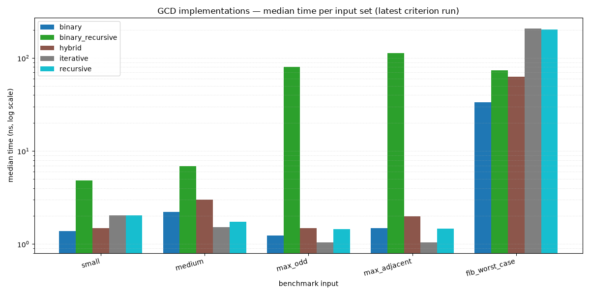

# binary_gcd

Five GCD implementations for `i64`, with a test suite, criterion benchmarks, and a plotting script.

## Implementations (`src/lib.rs`)

| function | approach |
| --- | --- |
| `gcd_recursive` | recursive Euclidean algorithm |
| `gcd_iterative` | iterative Euclidean algorithm (modulo based) |
| `gcd_binary_recursive` | recursive binary GCD (Stein's) |
| `gcd_binary` | iterative binary GCD, with an early exit once the running minimum reaches 1 (`gcd(k, 1) == 1`); the loop terminates on `diff == 0` |
| `gcd_hybrid` | Lehmer-style hybrid: binary (subtract + shift) steps when quotients are small, a single modulo when the bit lengths differ by 3+ (quotient ≥ 4) |

All return `gcd(a, b)`, and each strips common factors of two up front.

## Tests (`cargo test`, 15 tests)

For every implementation:

- **known values** — hand-verified vectors, including zeros, equal inputs, multiples, `i64::MAX` pairs, and consecutive Fibonacci numbers (F(91), F(92));
- **exhaustive small sweep** — all 4,096 pairs in `[0, 64)²` against an independent Euclid reference;
- **random cross-check** — 200,000 seeded (splitmix64) pairs mixing tiny, small, and full-range values against the same reference.

## Benchmarks (`cargo bench`, criterion)

Input sets benched: `small (56, 98)`, `medium (1071, 462)`, `fib_worst_case (F(91), F(92))`, `max_odd (i64::MAX, 2)`, `max_adjacent (i64::MAX, i64::MAX - 1)`.

Latest run (median, ns):

| input | recursive | iterative | binary_recursive | binary | hybrid |
| --- | --- | --- | --- | --- | --- |
| small | 2.039 | 2.037 | 4.841 | **1.376** | 1.488 |
| medium | 1.737 | **1.524** | 6.867 | 2.218 | 3.004 |
| fib_worst_case | 203.250 | 207.790 | 73.817 | **33.511** | 63.303 |
| max_odd | 1.449 | **1.041** | 80.711 | 1.239 | 1.488 |
| max_adjacent | 1.462 | **1.041** | 113.732 | 1.486 | 1.982 |

Machine: Apple M4, 10-core (macOS, 2026-08-20). `gcd_binary` is the fastest all-around: ~6× faster than the Euclidean variants on the Fibonacci worst case, and within a fraction of a nanosecond of iterative Euclid on the tiny-operand cases where a single modulo wins.



## Plotting

```sh
./.venv/bin/python scripts/plot_benchmarks.py benchmarks.png
```

Reads `target/criterion/gcd_*/new/estimates.json` (from the latest `cargo bench`) and renders a log-scale grouped bar chart. Add new implementation names to `IMPLS` in the script when the crate grows.

## Quick start

```sh
cargo test      # run the test suite
cargo bench     # run the criterion benchmarks
```
